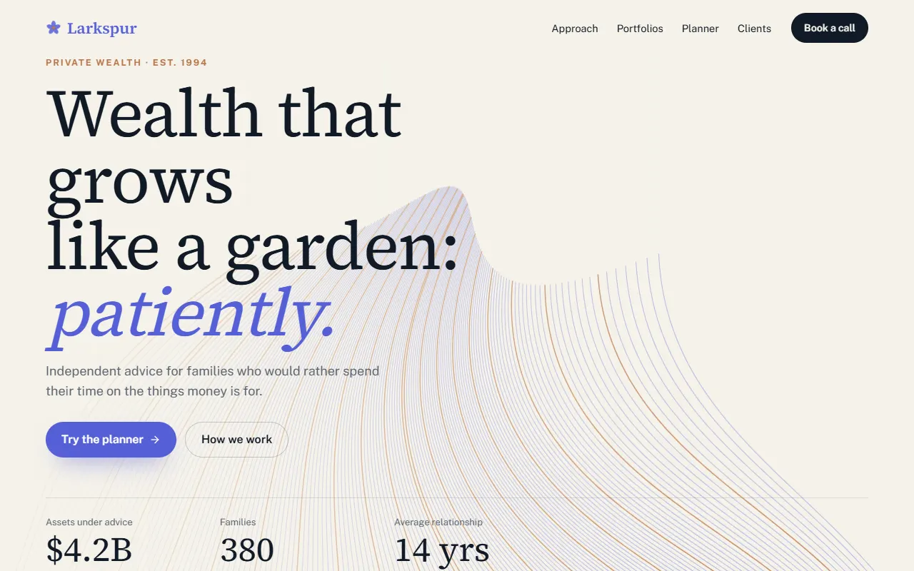
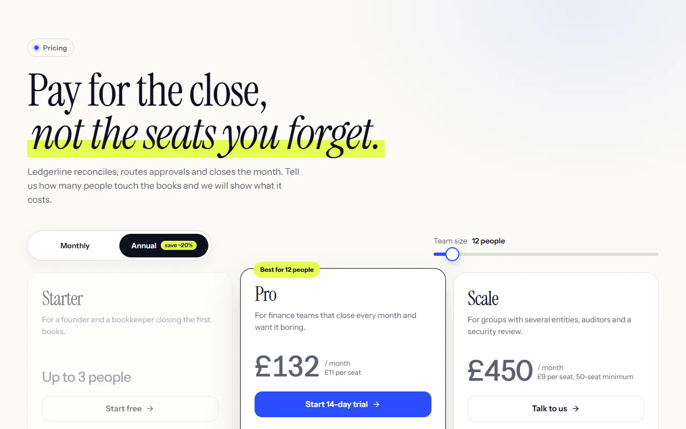
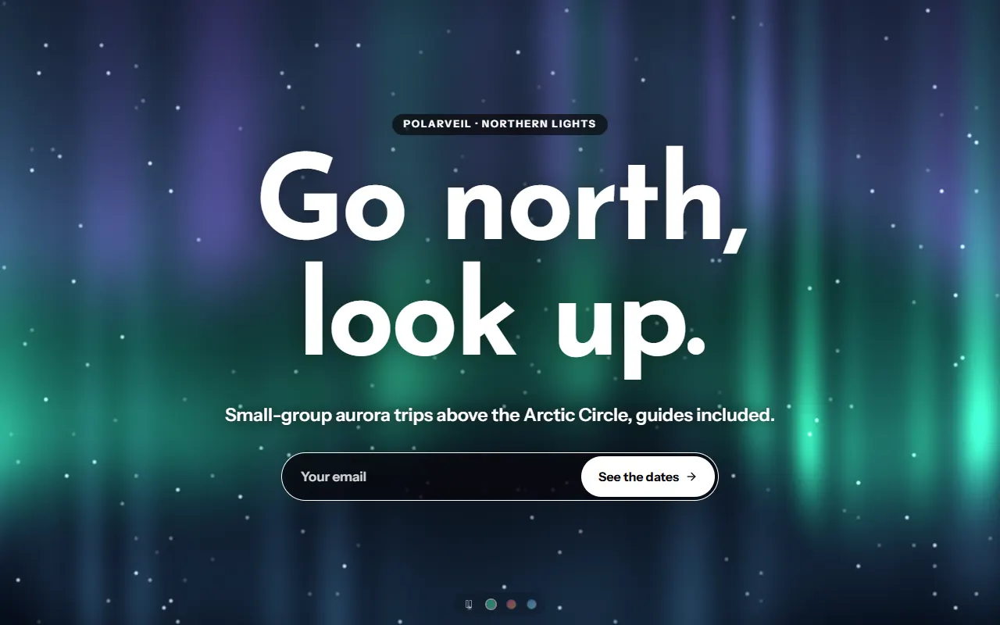

# Free motion templates by BuildMotions

Three free, animated templates from [BuildMotions](https://buildmotions.com), a library of original
motion website templates with live previews, source code and AI prompts for Claude Code, Cursor, v0,
Lovable and Codex. Everything here is code (React, Next.js, TypeScript and CSS Modules); there are no
images or videos to download.

| Template | What it is | Live preview |
|---|---|---|
| **Larkspur** | A private-wealth website in coded motion: a field of rising lines, a sticky story where a seedling blooms, morphing portfolio charts and a planner. | [buildmotions.com/templates/larkspur](https://buildmotions.com/templates/larkspur) |
| **Ledgerline** | A SaaS pricing section with a sliding billing toggle, a team-size slider and a recommended plan that moves with you. | [buildmotions.com/templates/ledgerline](https://buildmotions.com/templates/ledgerline) |
| **Polar Veil** | A WebGL aurora background that loops without a seam, pauses off screen and falls back to a still. | [buildmotions.com/templates/polarveil](https://buildmotions.com/templates/polarveil) |





## Run it

Requires Node.js 20 or newer.

```bash
npm install
npm run dev
```

Open http://localhost:3000 and pick a template, or go straight to `/larkspur`, `/ledgerline` or `/polarveil`.

## Use it

- Copy a template's folder from `components/showcase/` and its page from `app/<name>/page.tsx` into your
  own Next.js project.
- Edit the copy in each template's `data.ts` and the colours and fonts in its `.module.css` file.
- Every animation respects `prefers-reduced-motion`.

## Rebuild or extend it with AI

Each template on BuildMotions has a structured prompt (layout, motion timings, content and acceptance
checks) for Claude Code, Cursor, v0, Lovable and Codex. The prompts for these three are free on their
template pages. The full library of 180+ templates, prompts and source code is at
[buildmotions.com](https://buildmotions.com).

## Licence

The code in this repository is released under the [MIT licence](LICENSE).
